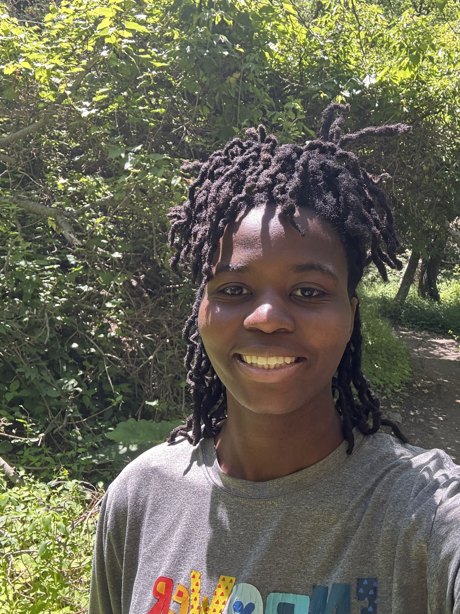

  

  

    <h2>Welcome</h2>
    

      Your existing welcome text goes here.
    

  

# Hello, I'm Rachel Foster.

I'm an undergraduate mathematics student interested in mathematical inquiry, mathematics education, teaching, and questions of access and belonging in STEM.

## What I'm interested in

I'm interested in exploring mathematics, understanding how people learn, and thinking about how educational environments shape students' experiences.

## Looking ahead

I hope to pursue graduate study in mathematics and eventually become a professor at a liberal arts institution.

This website is a space to document my academic interests, share projects, and reflect on my experiences as I continue learning.
